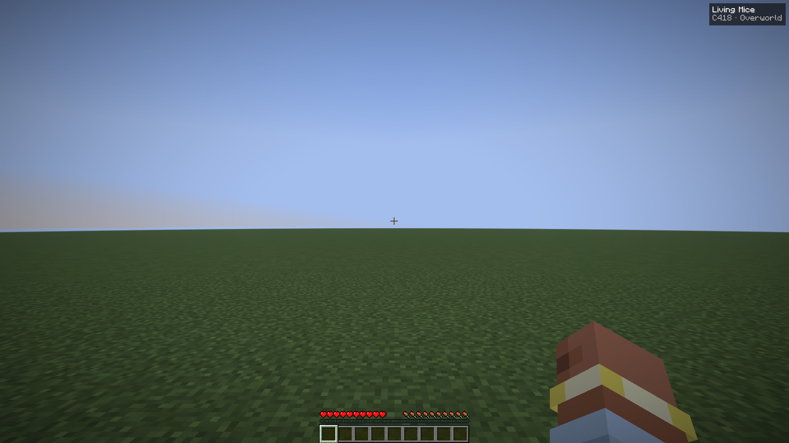
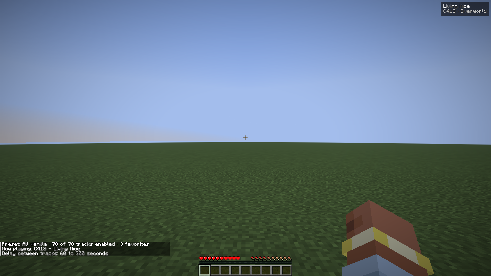
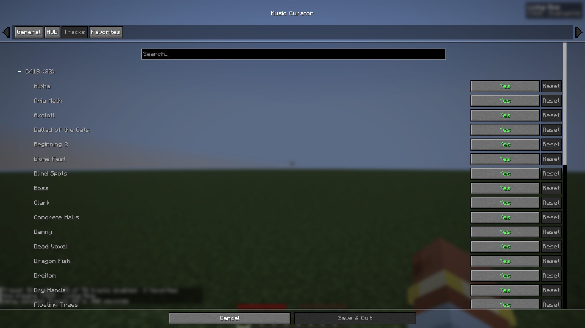
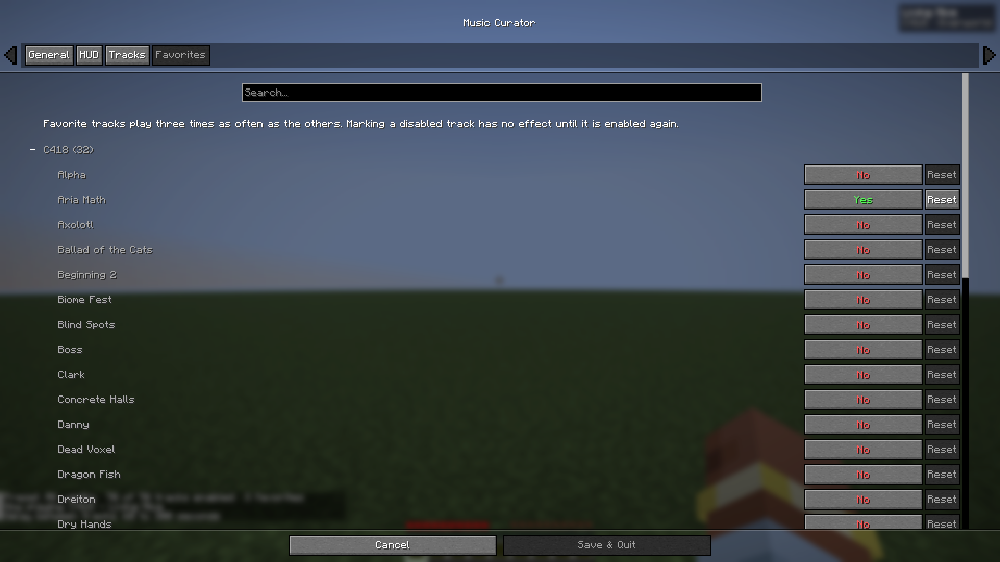

# Music Curator

Client mod for Minecraft 26.3, 26.2, 1.21.11 and 1.21.1, on Fabric and NeoForge. Pick which vanilla music can play, mark favorites, set how often music plays, pause it without losing your place, and see the current track in a small HUD. Available in English and French.

| The HUD | `/musiccurator status` |
| --- | --- |
|  |  |
| **Tracks tab** | **Favorites tab** |
|  |  |

The screenshots are produced by the client game tests (`ScreenshotTest`); to refresh them, run `./gradlew :26.2-fabric:runClientGameTest` and copy `versions/26.2-fabric/build/run/clientGameTest/screenshots/000N_music-curator-<name>.png` to `docs/screenshots/<name>.png`.

## Requirements

Cloth Config provides the settings screen. Tested with these versions:

**Fabric** (Fabric Loader 0.19.3 or newer)


| Minecraft | Java | Fabric API (required) | Cloth Config (required) | Mod Menu (optional) |
| --------- | ---- | --------------------- | ----------------------- | ------------------- |
| 26.3      | 25   | 0.162.0+26.3          | 26.3.159                | 21.0.0              |
| 26.2      | 25   | 0.152.2+26.2          | 26.2.155                | 20.0.0-beta.3       |
| 1.21.11   | 21   | 0.141.6+1.21.11       | 21.11.153               | 17.0.1              |
| 1.21.1    | 21   | 0.116.17+1.21.1       | 15.0.140                | 11.0.5              |


Mod Menu only adds a config button to the mods list.

**NeoForge**


| Minecraft | Java | NeoForge  | Cloth Config (required) |
| --------- | ---- | --------- | ----------------------- |
| 26.3      | 25   | 26.3.0.76 | 26.3.159                |
| 26.2      | 25   | 26.2.0.90 | 26.2.155                |
| 1.21.11   | 21   | 21.11.45  | 21.11.153               |
| 1.21.1    | 21   | 21.1.221  | 15.0.140                |


## Install

Download the jar matching your loader and Minecraft version (`music-curator-<loader>-<version>+<minecraft>.jar`, e.g. `music-curator-neoforge-1.3.0+1.21.1.jar`) and drop it into your `mods/` folder, along with Cloth Config for the same loader, and Fabric API on Fabric. The settings screen also opens with `/musiccurator config` or the *Open settings* keybind.

## Settings

Open with `/musiccurator config`, the *Open settings* keybind, or the mods list: Mod Menu → Music Curator → Config on Fabric, Mods → Music Curator → Config on NeoForge. Sections:

- **General** — master toggle, preset, min/max delay between tracks, fixed interval
- **HUD** — show/hide, anchor, x/y offset, composer/category line
- **Tracks** — every vanilla track of your Minecraft version, grouped by composer, each with its own toggle
- **Favorites** — tracks that play three times as often as the others

Picking a preset replaces the whole track selection. Toggling individual tracks switches the preset to *Custom*, unless the result matches a preset. Disabling the track that is playing stops it right away.

## Presets


| Preset                | Alias    | Plays                                  |
| --------------------- | -------- | -------------------------------------- |
| All vanilla           | `all`    | every track                            |
| C418 only             | `c418`   | tracks composed by C418                |
| Modern only (no C418) | `modern` | every track not composed by C418       |
| Custom                | —        | your own selection from the Tracks tab |


A preset is a rule, not a snapshot: when an update adds tracks or corrects a composer, your preset follows on the next launch. Presets never change your favorites.

## Commands and keybinds

Client-side commands:

- `/musiccurator skip` — play another track now
- `/musiccurator pause` — pause or resume the music
- `/musiccurator status` — preset, enabled tracks, favorites, current track and delays
- `/musiccurator config` — open the settings screen
- `/musiccurator hud toggle` — show or hide the HUD
- `/musiccurator preset <all|c418|modern>` — apply a preset

Keybinds for skip, pause/resume, HUD toggle and open settings are unbound by default — set them in Options → Controls → Key Binds → Music Curator. Their result shows above the hotbar.

## Notes

- Only background music is affected. Jukebox discs and all other sounds play as usual.
- When the current biome or situation has none of your tracks, a track from your selection plays instead. With every track disabled, no music plays.
- A new track never repeats the previous one when another is available, so skipping always changes the song.
- The delays apply to background music in worlds, where they replace vanilla's Options → Music & Sounds → Music Frequency (1.21.1 has no such option). The title screen, the Ender Dragon fight and the end credits keep the game's timing.
- Pausing freezes the current track and resuming continues it where it stopped; skipping while paused plays the next track. The pause lasts until you resume or restart the game, and the HUD shows it.

## Config file

Settings are saved to `config/music-curator.json`. `disabledSongs` lists the sound files that must not play, such as `music/game/sweden`, and `favoriteSongs` the ones that play more often. When you edit `disabledSongs` by hand, also set `"preset": "CUSTOM"`, otherwise the preset's rule replaces your list on the next launch.

If the file cannot be parsed, it is renamed to `music-curator.json.broken` and defaults are loaded, so you can fix it and rename it back.

## Build from source

Needs JDK 25 (it also compiles the Java 21 jars for 1.21.11 and 1.21.1).

The project builds every supported Minecraft version and loader from the same sources with [Stonecutter](https://stonecutter.kikugie.dev/): each pair is a Gradle subproject under `versions/<minecraft>-<loader>/`, whose `gradle.properties` holds its dependency versions, built by `build.fabric.gradle` (Fabric Loom) or `build.neoforge.gradle` (ModDevGradle). Code that differs between versions or loaders is wrapped in Stonecutter comments (`//? if >=26.1 { ... //?} else { ... //?}`, `//? if neoforge { ... //?}`); the committed sources are written for 26.2 on Fabric. Each loader has its own entrypoint (`MusicCuratorFabric`, `MusicCuratorNeoForge`); everything else is shared.

```
./gradlew build                                  # everything; jars land in versions/<minecraft>-<loader>/build/libs/
./gradlew :1.21.1-neoforge:build                 # a single version and loader
./gradlew :1.21.1-neoforge:runClient             # launch a dev client (all versions share the run/ folder)
./gradlew :26.2-fabric:runClientGameTest         # client game tests (Fabric 1.21.11+): opens the game, needs an audio device
./gradlew :1.21.11-fabric:runProductionClient    # run the built Fabric jar the way a player's launcher does
```

`runProductionClient` matters for Fabric 1.21.11 and 1.21.1: those versions are obfuscated, and only the built jar uses the production names the mixins must match.
